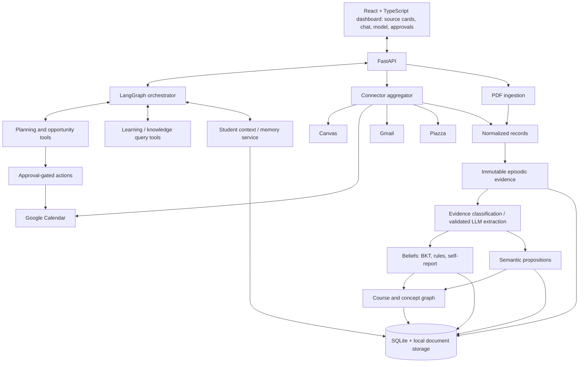
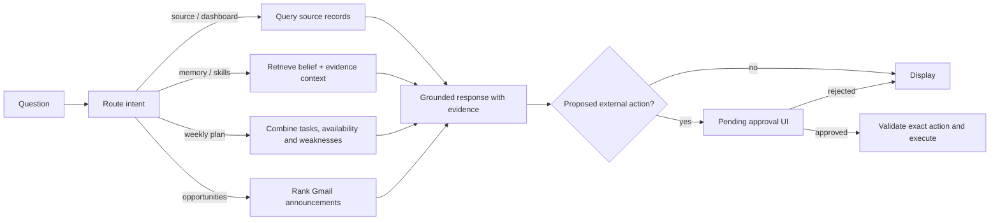

# NOVA — Claude Code Master Implementation Specification

**Status:** Working single source of truth | **Date:** 2026-11-07 | **Target:** local, live hackathon demo | **Time budget:** 2–4 remaining development hours | **Team:** multiple coding agents may work concurrently

> **Instruction to Claude Code:** Read this entire file before implementing anything. Treat the Product Invariants, P0 Acceptance Criteria, Data Contracts, and Agent Coordination Protocol as authoritative. Implement the application, not merely a proof-of-concept for BKT. Make practical choices without asking unnecessary questions, record decisions in the shared scratchpad, and continuously maintain a runnable main branch. Do not claim a real integration is working until it has been tested.

## 0. One-paragraph mission

NOVA is an **intelligent academic aggregation dashboard** that consolidates a student's data from **Canvas, Google Calendar, Gmail, Piazza, and uploaded documents** into a single React interface. A persistent **student memory / mental-model intelligence layer** ingests evidence from these sources and conversations, maintains structured and qualitative beliefs (knowledge, goals, motivation, engagement, preferences, workload), and exposes a course/concept knowledge graph. A conversational interface answers cross-source questions such as **“What systems topics am I struggling with?”**, **“What should I focus on this week?”**, and **“What classes should I take next?”** with source-backed explanations. NOVA proactively highlights relevant opportunities (e.g., research talks found in Gmail) and suggests study activities; **external actions require explicit student approval**. The central orchestration is built with **LangGraph**, backed by **FastAPI**, and presented in **React + TypeScript**, locally for a live demo.

**Crucial correction from earlier brainstorming:** NOVA is **not primarily a tutoring app or a BKT demo**. The dashboard + connector aggregation + conversational intelligence are the primary product. The mental model is one important differentiating feature. Existing historical quiz PDFs are valid learning evidence; NOVA does **not** require its own quiz generator to operate.

## 1. Product invariants / confirmed decisions

1. **Dashboard-first UX.** Show source-specific widgets plus a persistent cross-source memory chatbot and a student-model/graph view.
2. **Five source classes:** Canvas, Google Calendar, Gmail, Piazza, and uploaded course documents (PDFs, including graded historical quizzes). All desired for the end product. For the remaining hours, implement adapters, truthful mock fallbacks, then live reads in priority order.
3. **One central LangGraph orchestrator** handles question routing, context gathering, recommendations, and tool execution. Specialized *capabilities* (planning and learning/knowledge analysis) may be graph nodes; they do not need separate autonomous agent loops.
4. **Bidirectional learning/planning:** evidence about weak concepts changes study recommendations; deadlines, goals, and time availability change learning priorities.
5. **Mental model:** global student beliefs + course-level + concept-level state. Structured beliefs, immutable episodic evidence, semantic propositions, and a derived narrative. Graph connects courses/concepts/prerequisites/goals/evidence.
6. **Belief updates:** both app events and explicit student contributions trigger updates; agents submit *observations*, not unreviewed belief overwrites.
7. **Proactivity with approval:** recommendations may appear automatically after a sync or memory update, but do not write calendar events or send communications without explicit user approval.
8. **Live local demo:** React + FastAPI + LangGraph, no public deployment requirement.
9. **No fabricated facts or live-data claims:** no made-up Canvas deadlines, Gmail talks, quiz scores, course prerequisites, or connector success. Fixture data must be labeled “Demo data.”
10. **Time constraints:** optimize for an operational end-to-end product in 2–4 remaining hours, not research-complete memory modeling or production hardening.
11. **Multi-agent implementation:** distribute work by independent tasks, agree on API contracts first, and communicate through repository scratchpad/task board. Do **not** bake personal developer names into work ownership.

## 2. What users see: UX specification

### Primary route `/` — consolidated dashboard

Header: NOVA, active student, connector sync/status indicators, refresh control.

**Priority panels / cards:**
- **Canvas — Tasks / Due Soon:** name, course, due date, completion state, source link where available; sortable by urgency.
- **Google Calendar — This Week:** upcoming events and free windows, timezone-aware; candidate study block visualization.
- **Gmail — Relevant Academic Opportunities:** research talks, seminars, recruiter/academic announcements; relevance rationale against student interests/goals; source/message date; do not misrepresent an undated announcement as an upcoming event.
- **Piazza — Course Discussions:** instructor announcements, relevant course questions, updates, links when permitted.
- **Documents — Academic Sources:** uploaded PDFs, extraction status, course association, evidence/source references.
- **NOVA Insights / Priorities:** focus areas, possible knowledge blind spots, recommended action(s), evidence links and confidence caveats.
- **Persistent Ask NOVA chatbot:** prominently visible within dashboard; accepts cross-source questions and displays source-backed responses and approval-required action proposals.
- **My Student Model:** accessible panel/tab; concept mastery, student self-confidence, evidence counts, goals and preferences; expandable **knowledge graph** of course→concept→prerequisite and concept→evidence relationships. A structured list is a suitable graph fallback if visualization is not ready.

Suggested routes/tabs: `/` Dashboard; `/knowledge` Student Model & Graph; `/documents` Uploads; `/sources` Connector statuses. Chat remains accessible from home; do not push it behind a secondary page.

### Three must-support prompts

1. **“What systems topics am I struggling with?”** Retrieve systems course concepts, available historical quiz/assessment evidence, estimates, self-report confidence, misconceptions, provenance, and uncertainty. Do not equate a student's questions with incorrect mastery.
2. **“What should I focus on next this week?”** Combine weak concepts, explicit goals, Canvas deadlines, available Calendar time, and other relevant signals. Propose a grounded, feasible study session; do not automatically schedule.
3. **“What classes should I take next?”** Consider explicitly stated academic/career goals, completed course records, skills, and **verified** courses/prerequisites. If no catalog/prerequisite data exists, say so and recommend subject areas or request catalog input; never hallucinate course offerings.

### Gmail opportunity scenario

The student has explicitly expressed an interest in embodied AI/robotics. Gmail returns a real academic talk announcement. Extract *speaker, subject, time, timezone, venue/URL* if present; rank against interests; display a source-backed recommendation and ask before adding to Calendar. Missing event date/time means “worth reviewing,” **not** “upcoming at X.” For hackathon, manual Gmail sync and on-screen card are sufficient; recurring background notification infrastructure is out of scope.

## 3. Technical topology



**Key boundaries:**
- The **aggregator** powers the dashboard whether or not mental-state inference is available.
- The **memory engine** persists evidence and makes grounded updates; LangGraph never simply rewrites the belief database using an LLM-generated story.
- The **knowledge graph** is a small set of nodes and edges stored in SQLite/JSON, not a required Neo4j deployment.
- The **chat agent** gets actual retrieved evidence and user state from tools. It must not pretend it queried connectors when it actually used demo fixtures.

### Minimal LangGraph sequence



A LangGraph `StateGraph` with simple router + capability nodes is sufficient. Avoid intricate multi-agent handoffs and open-ended recursive loops.

## 4. Source connectors

**Normalize before displaying, reasoning, or memory ingestion.** Separate data retrieval from interpretation.

| Provider | Read-only MVP content | Secondary capabilities | Notes |
|---|---|---|---|
| Canvas | Courses, assignments, due dates, optionally grades | Assignment deep links | Use available token; limit requests; gracefully handle access errors |
| Google Calendar | Upcoming events, availability/free-busy | Create approved study events | Store token server-side; timezone-aware |
| Gmail | Recent relevant academic announcements | Talk extraction and opportunity ranking | Least-privilege readonly mail access; manual sync; avoid indiscriminate ingestion of private emails |
| Piazza | Accessible classes, announcements/questions | Course-specific relevant discussions | Access/API shape may be constrained; validate first and use labeled fixture if unsupported |
| Local PDFs | Uploaded lecture materials, notes, graded past quizzes | Extract concept evidence, citations and Q&A | Preserve page refs; grade parsing must be evidence-backed |

**Connector implementation contract:** `sync(student_id) -> {records, fetched_at, status, errors}`. A provider adapter returns normalized records and handles its own auth/timeouts. A failed provider must never blank unrelated cards. Show `connected`, `needs_auth`, `failed`, or `demo_data` status in the UI. Deduplicate by `(provider, external_id)`; preserve source URL and retrieval timestamp.

### Credentials

Use `.env.example` with variables such as `LLM_API_KEY`, `CANVAS_BASE_URL`, `CANVAS_API_TOKEN`, `GOOGLE_CLIENT_ID`, `GOOGLE_CLIENT_SECRET`, `GOOGLE_TOKEN_FILE` (local only), and Piazza settings as actually supported. Avoid guessing that Piazza has a particular official API or Google token form. Never commit `.env`, credentials, OAuth tokens, raw private mail exports, or student records. Support `DEMO_MODE=true` and per-adapter fallback fixtures.

## 5. Canonical data contracts (freeze before parallel coding)

All timestamps use ISO 8601 with timezone offsets or UTC; student/course/concept IDs are stable. Use Pydantic backend schemas and TypeScript frontend counterparts. Exact names below are recommended contracts; if changes are required, update this file and the coordination scratchpad **before** implementing incompatible interfaces.

### `SourceRecord`

```json
{
  "id": "src_gmail_001",
  "student_id": "demo_student",
  "provider": "gmail",
  "external_id": "message_123",
  "kind": "event_announcement",
  "title": "Research Talk: Embodied AI",
  "body": "Seminar announcement text ...",
  "source_url": null,
  "occurred_at": "2026-11-07T15:00:00Z",
  "fetched_at": "2026-11-07T15:05:00Z",
  "course_id": null,
  "concept_ids": ["embodied_ai"],
  "metadata": {"event_start": null, "speaker": "Guest Researcher"},
  "is_fixture": true
}
```

Kinds: `assignment`, `calendar_event`, `message`, `discussion`, `event_announcement`, `document`, `assessment`, `self_report`, etc. Metadata can be provider-specific but validated when used for side effects.

### `Observation` / immutable episodic memory

```json
{
  "event_id": "obs_123",
  "student_id": "demo_student",
  "source_record_id": "src_pdf_007",
  "source": "pdf_assessment",
  "event_type": "assessment_answer",
  "course_id": "systems",
  "concept_id": "cache_coherence",
  "occurred_at": "2026-10-20T12:00:00Z",
  "payload": {"correct": false, "question_id": "Q3", "evidence_text": "Marked incorrect on Q3", "page": 2},
  "extraction_confidence": 0.9,
  "is_fixture": true
}
```

`event_id` is idempotent: re-ingestion must not double-apply updates. Unverified extracted evidence can be recorded with `status=pending_review` rather than immediately changing mastery. Preserve document ID/page and source content references.

### `Belief`

```json
{
  "id": "belief_cache_mastery",
  "student_id": "demo_student",
  "scope": {"level": "concept", "course_id": "systems", "concept_id": "cache_coherence"},
  "key": "knowledge.mastery",
  "value": 0.42,
  "evidence_strength": "moderate",
  "status": "estimated",
  "evidence_ids": ["obs_123"],
  "updated_at": "2026-11-07T15:15:00Z",
  "expires_at": null,
  "version": 2
}
```

**Important:** numerical mastery is a BKT model estimate; `evidence_strength` describes support, not a second calibrated probability. Narrative summaries must not become an independent source of authority.

### `SemanticProposition`

```json
{
  "id": "prop_01",
  "student_id": "demo_student",
  "statement": "Student prefers concise visual explanations of systems topics",
  "scope": "global",
  "status": "self_reported",
  "evidence_ids": ["obs_chat_04"],
  "updated_at": "2026-11-07T15:15:00Z"
}
```

Only persist scoped, useful, evidence-backed propositions. Distinguish `self_reported`, `inferred`, `confirmed`, `disputed`, `expired`. Students should be able to correct an interpretation.

### `GraphNode` / `GraphEdge`

```json
{
  "nodes": [
    {"id": "course:systems", "type": "course", "label": "Computer Systems"},
    {"id": "concept:cache_coherence", "type": "concept", "label": "Cache Coherence"}
  ],
  "edges": [
    {"source": "course:systems", "target": "concept:cache_coherence", "relation": "contains"}
  ]
}
```

Recommended relations: `contains`, `prerequisite_of`, `assessed_by`, `supports_goal`, `related_to`. Prerequisite relations must come from verified content or explicitly labeled fixtures; don't let an LLM arbitrarily establish official course prerequisites.

### `Recommendation` / approval action

```json
{
  "id": "rec_01",
  "student_id": "demo_student",
  "type": "study_session",
  "title": "Review cache coherence",
  "reason": "An earlier quiz contains evidence of a concept gap and a systems deadline is approaching.",
  "evidence_ids": ["obs_123"],
  "suggested_start": "2026-11-09T15:00:00-05:00",
  "duration_minutes": 25,
  "status": "pending",
  "proposed_action": {"provider": "google_calendar", "operation": "create_event", "args": {"title": "Review cache coherence"}},
  "is_fixture": true
}
```

Proposals must be reviewed with exact title/time/duration before execution. `POST /approve` checks the user identity, recommendation status, and action data; prevent duplicate writes.

## 6. Memory and belief-update logic

### Four separate concepts

1. **Raw source records:** what Canvas/Calendar/Gmail/Piazza/PDF actually contained.
2. **Episodic memory:** immutable, timestamped observations tied to source and evidence.
3. **Structured student model:** global goals/preferences/motivation/engagement; per-course workload/priorities; per-concept knowledge/mastery/misconceptions and *separate* self-rated confidence.
4. **Semantic memory + graph:** evidence-backed propositions plus relationships; a derived narrative for chat consumption.

### Updates by type

| Event | Update | Guardrail |
|---|---|---|
| Graded historical quiz answer | BKT update for mapped concept | Only when correctness and topic mapping are reliably extracted |
| Student says “I know X” | Self-reported confidence | Never update demonstrated mastery as if it were quiz evidence |
| Student states goal/preference | Explicit proposition/direct update | Preserve source, allow correction |
| Calendar or Canvas changes | Recompute workload/availability | These are source-backed facts, not mental-health inferences |
| Completed learning session | Engagement count/recency | Don't infer motivation from activity alone |
| “Feeling unmotivated today” | Short-lived self-report | Expire and do not treat as permanent psychological trait |
| Gmail academic talk | Event fact + interest-match recommendation | Do not invent event time or attendee interest |

### Bayesian Knowledge Tracing (BKT)

For each concept maintain a probability of a hidden “mastered” state. Use parameters for slip `s`, guess `g`, and learning transition `T` plus prior `p`. Following an observed correct/incorrect response:

```python
def bkt_update(p: float, correct: bool, slip=0.1, guess=0.2, learn=0.1) -> float:
    if correct:
        numerator = p * (1 - slip)
        denominator = numerator + (1 - p) * guess
    else:
        numerator = p * slip
        denominator = numerator + (1 - p) * (1 - guess)
    posterior = numerator / denominator
    return posterior + (1 - posterior) * learn
```

These defaults are illustrative and **not calibrated**. Record historical quiz timestamps and avoid interpreting old single-question evidence as a current diagnosis of mastery. For repeated evidence, process chronologically and avoid duplicate event updates.

**Blind-spot signal** (candidate, not diagnosis): self-confidence greater than BKT-estimated mastery by an illustrative threshold (e.g. 0.3), **and sufficient trustworthy assessment evidence**. Keep self-report and measured estimates distinct.

**Prioritization**: combine `goal_relevance × concept_gap × deadline_urgency × feasible_study_time` with transparent heuristic weights. Explain the factors rather than pretending to have a trained recommender. The old playbook's `mastery × retrievability` formula should **not** be treated as calibrated without validating the relationship.

### ToM, GUM, and FSRS decisions

- **AutoToM (Johns Hopkins, 2025):** conceptual inspiration for competing explanations, uncertainty and belief revision, **not** a complete algorithm to implement under the deadline. Do not build automated hypothesis-space search or many-step Bayesian inverse planning.
- **GUM-inspired semantic proposition revision:** useful as a later P1/P2 addition; MVP can use explicit facts/preferences and simple dedup/replace rules, with an optional single LLM consolidation step.
- **FSRS / forgetting:** optional P2; avoid integration complexity and avoid treating BKT mastery as an actual recall probability. A simple stale-evidence indicator is sufficient.
- **Deep KT, per-user fine-tuning, Neo4j, vector DB, long-running autonomous agent loops:** out of scope.

### Historical PDF assessment handling

- PDF upload is a first-class input, not a quiz-generation byproduct.
- Extract page-referenced text; identify course/concept, student answers, correctness/grades if present.
- Do **not** infer correctness from a bare question sheet. If no grading evidence, index as study material and leave knowledge estimates unchanged.
- Support a demo fixture consisting of a PDF that actually contains graded answers or an explicit companion answer sheet. Cite page/question in responses.
- Retrieval can use simple text chunking + keyword search for demo; add embeddings only if preexisting or clearly beneficial.

## 7. API routes (contract-first)

Implement these in FastAPI. Return typed JSON and meaningful errors. Prefer a unified `app/api` layer rather than two separate backend servers.

| Method | Route | Output / behavior |
|---|---|---|
| `GET` | `/api/health` | Backend/DB/provider statuses |
| `GET` | `/api/dashboard` | Grouped source cards, insights, sync statuses |
| `GET` | `/api/connectors` | Per-provider availability/auth/demo-state |
| `POST` | `/api/connectors/{provider}/sync` | Fetch, normalize, dedup, persist; errors per provider |
| `POST` | `/api/documents/upload` | Parse and persist PDF with page references |
| `GET` | `/api/documents` | Uploaded document list/status |
| `POST` | `/api/memory/ingest` | Accept source records/observations idempotently; dispatch updates |
| `GET` | `/api/memory/context?student_id=&query=&agent=` | Relevant beliefs, facts, propositions, evidence |
| `GET` | `/api/memory/graph?student_id=` | Nodes/edges + associated belief summary |
| `GET` | `/api/memory/history?student_id=` | Evidence and belief update history |
| `POST` | `/api/chat` | `message`, `student_id`, optional conversation history -> grounded answer and optional recommendations |
| `POST` | `/api/recommendations/{id}/approve` | Confirm and execute exact, validated proposed action |
| `POST` | `/api/recommendations/{id}/reject` | Persist rejection, no external write |

**Core cross-agent contract:** `/api/memory/context`. A memory response includes: `narrative`, `facts`, `relevant_beliefs`, `source_records`, `evidence_refs`, `uncertainties`, and `state_version`. The orchestrator uses these to ground responses. For constrained time, these may be in-process service calls internally while the HTTP routes remain available.

### Chat response example

```json
{
  "answer": "Your earlier Systems quiz suggests additional practice with cache coherence. There is insufficient graded evidence yet to evaluate synchronization.",
  "sources": [{"source_record_id": "src_pdf_007", "label": "Systems quiz, p. 2, Q3"}],
  "beliefs_used": ["belief_cache_mastery"],
  "uncertainties": ["Mastery parameters are illustrative", "Historical evidence may be stale"],
  "proposed_recommendations": []
}
```

## 8. Recommended repository layout

```text
nova/
├── README.md
├── AGENTS.md
├── NOVA_CLAUDE_IMPLEMENTATION.md
├── .env.example
├── .gitignore
├── docker-compose.yml                  # optional; don't block local launch
├── coordination/
│   ├── TASKS.md
│   ├── SCRATCHPAD.md
│   ├── DECISIONS.md
│   └── CONTRACTS.md
├── contracts/
│   ├── openapi.json                     # optionally generated
│   └── examples/
│       ├── source_record.json
│       ├── observation.json
│       └── context_response.json
├── backend/
│   ├── requirements.txt or pyproject.toml
│   ├── app/
│   │   ├── main.py
│   │   ├── api/{dashboard,connectors,documents,memory,chat,recommendations}.py
│   │   ├── schemas/{source,observation,belief,graph,recommendation}.py
│   │   ├── services/{aggregation,document_ingest,opportunity_ranking}.py
│   │   ├── connectors/{canvas,calendar,gmail,piazza,base}.py
│   │   ├── memory/{store,bkt,updates,context,graph,propositions}.py
│   │   ├── orchestration/{graph,nodes,tools}.py
│   │   └── db.py
│   └── tests/
├── frontend/
│   ├── package.json
│   └── src/
│       ├── App.tsx
│       ├── api/client.ts
│       ├── components/{SourceCard,ChatPanel,KnowledgePanel,ApprovalCard}.tsx
│       └── pages/{Dashboard,Knowledge,Documents,Sources}.tsx
├── fixtures/
│   ├── source_records.json
│   ├── student_profile.json
│   ├── knowledge_graph.json
│   └── demo_scenario.md
└── scripts/
    └── seed_demo.py
```

Use Python + SQLite and simple file storage locally. **This tree is a suggested target, not a requirement to scaffold all empty modules.** Write only needed files; keep everything runnable.

## 9. Multi-agent task system and shared scratchpad

Before spawning coding subagents, initialize three coordination files in the repository.

### `coordination/TASKS.md`

One row per task, with ID, priority, dependencies, owner/agent ID, status, files owned, acceptance test, and latest commit. Use statuses `TODO`, `CLAIMED`, `IN_PROGRESS`, `BLOCKED`, `READY_FOR_REVIEW`, `DONE`. **Only one agent owns a task at a time.**

### `coordination/SCRATCHPAD.md`

Append-only human-readable progress notes:

```text
[YYYY-MM-DD HH:MM TZ] agent-id | task-id | START
Files: backend/app/memory/...
Contract assumptions: ...
Blockers: none
Next handoff: GET /api/memory/context returns sample JSON

[YYYY-MM-DD HH:MM TZ] agent-id | task-id | DONE
Commit: <hash>
Tests: ...
Interfaces changed: ...
Needs integration: ...
```

### `coordination/DECISIONS.md`

Short ADR-style entries: `ADR-001`, status, decision, rationale, consequences; log any schema/stack changes. `CONTRACTS.md` documents frozen API payloads and version changes.

### Safe collaboration rules

- Coordinator freezes interfaces and fixtures first, then distributes **independent file scopes**.
- Every agent reads `AGENTS.md`, this spec, `TASKS.md`, `CONTRACTS.md`, and last scratchpad entries before modifying code.
- Claim a task **before** editing; record touched files; avoid multiple agents editing `main.py`, shared schemas, or `package.json` concurrently.
- Prefer separate branches/worktrees per agent with integration through a coordinator, or strictly disjoint file scopes if sharing a workspace. Do not rely on uncommitted changes in another agent's worktree.
- An agent changes a shared contract only after logging it as a blocking proposal; coordinator approves and broadcasts update.
- Agents must provide working endpoints/components, tested against mock contracts, not placeholder scaffold-only output.
- Merge in small verified increments. Immediately rerun smoke tests after each merge. If a tool lacks shared file access, use GitHub issues/PRs or a coordinator-managed log rather than assuming scratchpad synchronization.
- Do not commit real private student data, OAuth credentials, or sensitive Gmail content to the repository.
- Never falsely mark integrations `DONE`: require a successful live call or label `MOCK_ONLY`.

## 10. P0/P1/P2 task backlog

| ID | Priority | Deliverable | Dependency | Acceptance test |
|---|---|---|---|---|
| T00 | P0 | Repo bootstrap, dev scripts, `.env.example`, coordination files | None | API + UI boot locally |
| T01 | P0 | Pydantic/TS contracts, fixtures, SQLite tables | T00 | Example payloads validate |
| T02 | P0 | Dashboard shell + 5 source widgets + embedded chat panel | T01 | Cards render fixture data with demo labels |
| T03 | P0 | Connector adapter interface + normalized aggregate endpoint | T01 | GET dashboard returns grouped cards; failures isolated |
| T04 | P0 | PDF upload + page-referenced extraction | T01 | A supplied quiz PDF appears with page reference |
| T05 | P0 | Episodic store + BKT + separate confidence + minimal context retrieval | T01,T04 | Assessment evidence updates one concept, keeps provenance, idempotent |
| T06 | P0 | Minimal LangGraph router and grounded `/api/chat` | T03,T05 | Answers weak-topic and weekly-focus prompts using evidence |
| T07 | P0 | Planning/recommendation card with student approval UI | T06 | Proposed action appears; reject never writes externally |
| T08 | P0 | End-to-end demo integration + seed/reset script | T02,T03,T04,T05,T06,T07 | Live UI works through source→memory→chat→recommendation |
| T09 | P1 | Real Canvas read adapter | T03 | Verified live assignment appears |
| T10 | P1 | Real Calendar read + approved write | T03,T07 | Verified event read; approved write creates once |
| T11 | P1 | Real Gmail read + relevant talk extraction | T03,T05 | Verified message becomes sourced opportunity card |
| T12 | P1 | Real Piazza read adapter | T03 | Verified accessible discussion shows; else honest fallback |
| T13 | P1 | Semantic proposition store + derived narrative | T05 | Explicit goal/preference reflected in chat context |
| T14 | P1 | Graph view / list of course-concept relations | T05 | Student can inspect concept/evidence links |
| T15 | P2 | Advanced historical PDF grading extraction | T04 | Correctness extraction reviewed; no unsupported scores |
| T16 | P2 | FSRS/forgetting, deeper GUM/AutoToM ideas | T05,T13 | Only if core demo already works |
| T17 | P2 | Richer notes/tutoring/quiz generation | T04,T06 | Doesn't displace aggregator MVP |

**Priority order:** T00–T08 are the actual product proof. P1 integrations are valuable but must not jeopardize the live demo. Since credentials are reported ready, attempt real adapters once the fixture pipeline works, especially Canvas/Calendar and Gmail. Piazza should be isolated behind a feature flag if its API is difficult.

## 11. Time-boxed execution plan (relative to start; 2–4 hours)

### First 15–20 minutes — coordinator

- Create GitHub repo if authorized, branch rules, README, `.env.example`, coordination files, backend/frontend skeleton.
- Freeze `SourceRecord`, `Observation`, `Belief`, `/api/dashboard`, `/api/memory/context`, `/api/chat` response contracts.
- Write one deterministic demo scenario with a historical graded systems quiz and at least one Gmail event fixture; label fixtures honestly.
- Spawn agents on disjoint tasks: frontend dashboard; connectors/aggregator; memory/PDF; orchestrator/chat. Keep an integrator coordinating contracts.

### 20–80 minutes — parallel working slices

- Frontend agent: polished but simple responsive dashboard + source cards + chat + model tab, against fixtures.
- Connector agent: normalized records + dashboard API, Canvas/Calendar/Gmail/Piazza stub adapters that can fall back per provider.
- Memory agent: document processing and evidence provenance; BKT update; self-confidence and student goal storage; context retrieval.
- Orchestrator agent: minimal LangGraph graph, routing question→source/memory/planning→grounded response.
- Coordinator: check endpoints every 15–20 minutes and unblock schema mismatches.

### 80–120 minutes — integration / minimum demo

- Connect React to backend, orchestrator to memory/context, and source cards to aggregator.
- Demonstrate systems topic weakness from graded PDF evidence; show belief change and source link.
- Demonstrate weekly priority recommendation using source tasks and concept gap.
- Implement accept/reject UI; mocked calendar action if real API not verified (clearly labeled).
- **If only 2 hours remain, stop adding features now; stabilize and rehearse.**

### 120–180 minutes — real services (if time remains)

- Verify Canvas, Calendar, Gmail real read adapters individually; show connector status.
- Add Gmail talk extraction and preference relevance; don't schedule undated emails.
- Implement approved Calendar create with validation/idempotency and explicit confirmation.
- Attempt Piazza only when the other adapters and main flow are stable.

### 180–240 minutes — polish and backup

- Add graph/list visualization and semantic proposition summaries if stable.
- Run tests and manual script, handle broken credentials with fallback, seed reset, screenshot/record backup demo, rehearse pitch.
- Freeze code, avoid new dependencies and late architectural changes.

## 12. Acceptance tests / quality gates

### P0 integration scenario

1. Launch API and React locally from documented commands.
2. Dashboard displays five source panels (a panel may accurately say `demo_data`, `needs_auth`, or `not_available`).
3. Load a systems course + historical quiz with *verified graded answers* and document page references.
4. Ingest quiz evidence. BKT state for linked concept changes; unrelated concepts do not change; repeated ingest is idempotent.
5. Student asks **“What systems topics am I struggling with?”** Answer uses stored evidence, cites quiz page/question and expresses uncertainty.
6. Student asks **“What should I focus on this week?”** Response combines deadline/task records with concept-level evidence and shows a prioritized recommendation.
7. User can approve/reject recommended calendar action. Reject has no side effect. Approve writes externally **only if** real Calendar adapter is configured and verified; otherwise a clearly labeled simulated action.
8. Gmail/Calendar/Piazza/Canvas failures do not crash the rest of the dashboard.
9. Student model/graph screen shows concepts, grades/confidence provenance and recent updates; minimal structured representation acceptable.
10. No secrets or user-sensitive records exposed in frontend source, console logs, or git.

### Automated tests

- `test_bkt_updates_correct_and_incorrect`, `test_bkt_idempotency`, `test_self_report_does_not_change_mastery`, `test_question_pdf_without_grade_does_not_generate_score`, `test_connector_partial_failure`, `test_chat_response_has_source_refs`, `test_rejected_approval_no_calendar_write`, `test_approval_idempotent`, `test_opportunity_missing_date_no_fabricated_time`.
- Include smoke tests for `GET /api/health`, dashboard, memory context and chat.
- Use fake adapters for all external API tests.

### Live demo sequence (3–4 minutes, depending on event limit)

1. Open NOVA; show consolidated Canvas tasks, Calendar, Gmail opportunities, Piazza, and uploaded docs.
2. Open a graded historical quiz PDF; point to specific incorrect question/related systems concept.
3. Show concept belief/provenance updated. Ask “What systems topics am I struggling with?”
4. Ask “What should I focus on this week?” Show priority from both knowledge gap and upcoming deadline.
5. Surface a Gmail research talk relevant to student goals; show why it was selected and offer approval-gated calendar proposal.
6. Optionally open student concept graph to show evidence relationships.

## 13. Failure modes and fallback policy

- **Canvas API failure:** show labeled demo assignment fixture and error status; do not invent live due dates.
- **Gmail access unavailable:** show a clearly labeled example opportunity card, not an actual inbox claim.
- **Piazza API unavailable:** show `Unavailable`/fixture status; don't burn the entire hackathon on an undocumented connector.
- **Calendar OAuth failure:** display read-only fixture availability; demonstrate approval UI with a simulated action, explicitly labeled.
- **PDF scan/text extraction failure:** use a known machine-readable sample PDF or typed assessment fixture; don't infer grades from missing text.
- **LLM API failure:** deterministic intent routing and templated grounded answers for 3 demo questions.
- **Graph renderer failure:** list nodes/edges and evidence in an expandable table.
- **BKT too uncertain:** show assessment observations without unsupported numerical claims; keep dashboard and planning functional.

## 14. Security, privacy and correctness

- Consent and minimum necessary data; read-only scopes for connectors by default; isolate calendar write permission.
- Treat Gmail/Piazza/Canvas/PDF content as untrusted text; protect orchestration from instructions embedded in messages and documents.
- Encrypt/storage hygiene appropriate to local demo; `.gitignore` local DB, tokens and uploads if sensitive.
- Attribute sources and distinguish direct facts, inferred beliefs, self-report, and speculative hypotheses.
- Support a student-visible belief correction route if it fits P1; never permanently label psychology/personality on weak signals.
- Never infer motivation or mental-health conditions from a missed session, unanswered email, or grade.
- Use current local timezone for plans and schedule operations.

## 15. Definition of done

**NOVA is “working” when a real human can open one dashboard, see consolidated academic source cards, upload or access a historic graded quiz, ask grounded questions of their accumulated student model, receive a cross-source weekly focus recommendation, and explicitly approve/reject a proposed calendar action — all without the system making up evidence or hiding mock-data status.**

A locally functioning app with a handful of live and/or explicitly simulated source records is a better hackathon outcome than sophisticated research models that are invisible to the end user.

---

# CLAUDE CODE MASTER PROMPT — COPY/PASTE

You are the **technical lead and coordinating engineer for NOVA**, a 2–4-hour hackathon build. Read `NOVA_CLAUDE_IMPLEMENTATION.md` **in full** and treat it as the product and technical source of truth.

**Your mission is to build a running application, not merely summarize a plan.** Start by inspecting the repository. If empty, scaffold the smallest FastAPI + React/TypeScript + LangGraph codebase that supports a local demo. Use SQLite and minimal dependencies. The primary deliverable is a **unified dashboard aggregating Canvas, Google Calendar, Gmail, Piazza and PDFs, plus a prominently embedded chatbot that interacts with a growing student memory/belief model**. Do not misinterpret NOVA as a quiz generator or standalone learning agent.

**Operating protocol:**

1. Initialize or update `AGENTS.md`, `coordination/TASKS.md`, `coordination/SCRATCHPAD.md`, `coordination/DECISIONS.md`, and `coordination/CONTRACTS.md` from the definitions above. These files are the persistent shared coordination system. Record task ownership, dependencies, interface contracts, commits, tested status, blockers and next handoffs. Don't assume agents share scratchpad state across worktrees without git synchronization.
2. Produce a concise implementation sequence from the P0/P1/P2 backlog, then **start coding immediately**. Freeze API contracts first and create realistic, clearly labeled demo fixtures. If subagents are supported, delegate independent modules (dashboard, connector adapters, memory/PDF, LangGraph orchestration) to separate agents with non-overlapping files; keep integration and contracts under coordinator control. If subagents aren't supported, implement those modules sequentially in the same priority order. Don't wait for a team-member assignment.
3. Build the P0 end-to-end vertical slice: source records → dashboard cards → historical graded PDF evidence → immutable observation → BKT/structured belief update → context retrieval → LangGraph chatbot → grounded weekly recommendation → user approval/rejection UI.
4. Ingest historical quizzes as evidence. **Do not require generating a new quiz.** Never infer grades from an ungraded question PDF. Keep BKT mastery separate from self-reported confidence; keep goals, motivation and engagement as distinct state dimensions. Use a simple semantic proposition store and JSON/SQLite knowledge graph if time permits.
5. Connect real services only once the core app is running. Test each integration; display truthful status and fall back to visibly labeled fixtures. Prioritize Canvas/Calendar and Gmail relevant talk discovery; Piazza is best-effort. Never write to Calendar without a specific user approval, and never present mock results as actual user data.
6. Implement the three exemplar chat questions: struggling systems topics, this week's focus, and classes to take next. Cite actual source records for claims. For course recommendations without a verified course catalog, state the missing data rather than inventing offerings.
7. Keep the React dashboard as the main interface: Canvas tasks, calendar, Gmail opportunities, Piazza discussions, docs, insights, chatbot, and a belief/knowledge graph panel. Make it responsive and presentable without overbuilding styling.
8. Run automated tests and smoke tests. Repair failures, update task statuses and scratchpad after each milestone, and write exact run commands in `README.md`. Use live test evidence to distinguish verified integrations from mock-only ones.
9. Protect time: if only two hours remain, prioritize T00–T08 and the working demo; avoid FSRS, full AutoToM, deep GUM, production background notifications, complex OAuth setup, vector DB, and advanced course recommendations.
10. At the end, provide: (a) what runs, (b) how to start it, (c) tests run/results, (d) which sources are live vs fixture, (e) known gaps, and (f) the best next tasks for remaining agents. Never claim completion without implementation and testing evidence.

**Non-negotiables:** dashboard-first, cross-source chat, evidence/provenance, course/concept beliefs, central LangGraph orchestration, safe student approval for writes, no fabricated source data, and runnable MVP. Proceed with execution.

---

## Provenance and open assumptions

This specification consolidates confirmed NOVA decisions from the conversation and the uploaded **Hackathon Playbook: User Mental Model System**, Ayush Sehgal (November 7, 2026). The playbook recommended BKT, a concept map, an evidence extractor, ranker, optional FSRS, and optional GUM-style propositions. Its original focus on blind spots was broadened here per the subsequent product correction: **NOVA is a cross-source academic dashboard first.** No actual GitHub repository URL, exact provider API shapes, authenticated user data, verified course catalog, or tested connector implementations have been provided; coding agents must validate these rather than assuming them.
